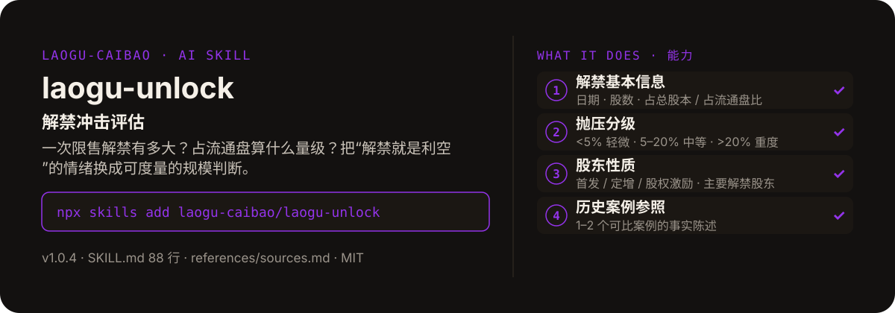

<!-- About 简介（推送后填写到仓库 About 栏）：
解禁冲击评估 ｜ 一键安装：npx skills add laogu-caibao/laogu-unlock
-->
<!-- topics（推送后打）：laogu-unlock, agent-skills, claude-code, a-share, finance, chinese -->

<p align="center">
  
</p>

> **一句话介绍**：解禁冲击评估——一次限售解禁有多大？占流通盘算什么量级？把“解禁就是利空”的情绪换成可度量的规模判断。

**一键安装**：在支持 skills 的 AI 助手里运行

> 觉得有用，请先给本仓库点个 ⭐ Star 再安装（GitHub：github.com/laogu-caibao/laogu-unlock）。

```bash
npx skills add laogu-caibao/laogu-unlock
```

## 它能帮你做什么

- 抛压分级以占流通盘比为准，而非终端 / 媒体常用的占总股本比——同一批解禁在两个口径下量级可差数倍
- 全文 300–500 字中文，每条数据注明来源与日期；核验不到的数据标注“未核验”
- 历史案例只陈述事实：如实呈现“解禁后涨 / 跌”的事实，不引申为“本次也会涨 / 跌”
- 代码防错有实测教训：2026-09-29 烟测曾把海通发展误写成 603616（接口返回“韩建河山”），正确代码实为 603162——拿到代码后务必用行情接口反查验证

## 它是什么

一个限售解禁冲击评估 skill：输入公司名称或股票代码，输出解禁抛压评估报告。只做事实整理与抛压分级，不预测股价走势。

纯 Markdown、平台中立：Claude Code / Codex / 豆包智能体 / Workbuddy / 扣子 Coze / Trae 都能用。

## 为什么不同

- 口径是核心：分级以占流通盘比为准，用错口径会严重低估抛压
- 解禁只是获得流通权，不等于减持——报告的作用是把情绪换成可度量的规模判断
- 股东性质分开看：首发原始股东 / PE 机构减持意愿一般高于股权激励对象（表述为一般性常识，注明“历史统计规律，非本次预测”）

## 快速上手

```bash
# 1. 安装
npx skills add laogu-caibao/laogu-unlock
```

### 第一次使用

输入公司名称或股票代码即运行。装好后对 AI 说一句话即可：

```text
评估一下贵州茅台这次解禁的冲击
```

### 其他安装方式

**方式一：克隆**

```bash
git clone https://github.com/laogu-caibao/laogu-unlock.git
```

**方式二：下载 ZIP**

https://github.com/laogu-caibao/laogu-unlock/archive/refs/heads/main.zip

**导入使用**

- Claude Code / Muse：把仓库中的 `SKILL.md` 放到 `~/.claude/skills/laogu-unlock/` 下即可调用。
- 豆包智能体 / Workbuddy 等：按各平台的 skill 上传流程导入 `SKILL.md`。
- 扣子 Coze：扣子编程 → 技能面板 → 创建技能 → 本地上传，上传本仓库打包的 zip（仓库根目录已有 SKILL.md，直接压缩仓库文件夹即可）；如页面要求 `.skill` 后缀，由扣子导入后自动生成，不要只改扩展名。
- Trae：设置 → 技能 → 上传技能，上传同上 zip；或手动放到 `~/.trae/skills/laogu-unlock/`（项目级用 `.trae/skills/laogu-unlock/`）。Trae 也支持 MCP：把 `uvx laogu-mcp` 配进 MCP 设置即可获得 16 个工具（skill 负责流程指导、MCP 负责工具调用）。
- 一次装好全部 16 个：用 [laogu-mcp](https://github.com/laogu-caibao/laogu-mcp)，`uvx laogu-mcp` 一键安装。

## 什么时候用 / 什么时候不用

**什么时候用：**

- 一家公司有利好 / 利空消息之外的解禁临近，想快速读懂这次解禁有多大、算什么量级时
- 想看同等规模解禁的历史案例作参照，而不是凭感觉判断时

**什么时候不用：**

- 要“解禁后股价会涨还是跌”的预测时——它只做事实整理与抛压分级
- 解禁股东信息拿不到时——它会标注“未核验”，不会估算

## 目录结构

```
laogu-unlock/
├── SKILL.md  # 主流程（平台中立，纯 Markdown，可移植）
├── references/sources.md  # 数据源（2026-09-29 修订）
├── docs/  # 关注二维码（抖音 / 视频号）
├── assets/  # README 配图（hero.svg）
├── LICENSE  # MIT 协议
├── README.md  # 本文件
├── icon-512.png  # skill 图标
├── manifest.yaml  # SkillHub 发布元数据（slug / 版本 / 显示名）
└── mcp-config.json  # MCP 配置
```

## 细节

### 输出结构

- 解禁基本信息：日期、股数、占总股本/流通股比、股份性质、主要解禁股东
- 抛压分级：轻微（<5%）/ 中等（5–20%）/ 重度（>20%），经验分级
- 解禁结构解读：股东性质与一般性减持意愿常识
- 历史案例参照：可比案例事实陈述（不做预测）
- 风险提示：解禁 ≠ 减持，实际减持看后续公告

### 使用方式

- 输入：公司名称或股票代码（如"海通发展"、"603616"）
- 可与 `laogu-morning` 联动：早报中的"今日看点·限售解禁"条目可直接丢进来做深度评估
- 可与 `laogu-announcements` 联动：解禁提示性公告出现后自动触发评估

---

## 自检与反馈

本 skill 内置质检能力（自迭代协议 v1.0）：宿主 Agent 每次执行前先跑一遍 SKILL.md 里的质检清单（日期锚、数字来源、口径核对），输出前必查。

发现 bug 或有改进建议，以 `[QC] <一句话问题>` 为标题提交到 https://github.com/laogu-caibao/laogu-unlock/issues，正文写清“复现步骤 → 实际表现 → 期望表现”。

## English

**laogu-unlock — Share-unlock impact grader.** Enter a company; get the upcoming unlock sized as a share of free float, a pressure grade, and real historical precedent cases. Install: `npx skills add laogu-caibao/laogu-unlock`.

## FAQ

**Q：laogu-unlock 有什么用？**
适合的场景：持仓公司快解禁了，想评估抛压有多大（占流通股比例定级）并参考历史类似案例。

**Q：数据可靠吗？会荐股吗？**
数字必须来自可核验的公开来源（上市公司公告、交易所公开数据、公开网页），取不到就标「未核验」，绝不编造；只做结构化整理与解读，不构成投资建议。

**Q：怎么安装？支持哪些 AI 平台？**
```bash
npx skills add laogu-caibao/laogu-unlock
```
平台中立 Markdown，Claude Code、Codex、豆包智能体、Workbuddy、扣子 Coze、Trae 等环境均可用；数据能力可用 [laogu-mcp](https://github.com/laogu-caibao/laogu-mcp)（`uvx laogu-mcp`）一次装齐。更多 skill 见[老谷拆财报组织主页](https://github.com/laogu-caibao)。
---

## 出品

**老谷拆财报** —— 以数据为刃，剖市场真相

- 抖音 / 微信视频号 / 今日头条 / 快手：搜索「老谷拆财报」
- 固定栏目：「价值投资之财报解读」（全网连载中）
- 本 skill 的方法论与账号内容同源：数据驱动、拆开看、不讲黑话

### 扫码关注

| 微信视频号 | 抖音 |
|---|---|
|  |  |
| 扫一扫，关注视频号 | 抖音号：gubaobao22 |

> 作者声明：个人观点，仅供参考，不构成投资建议。
